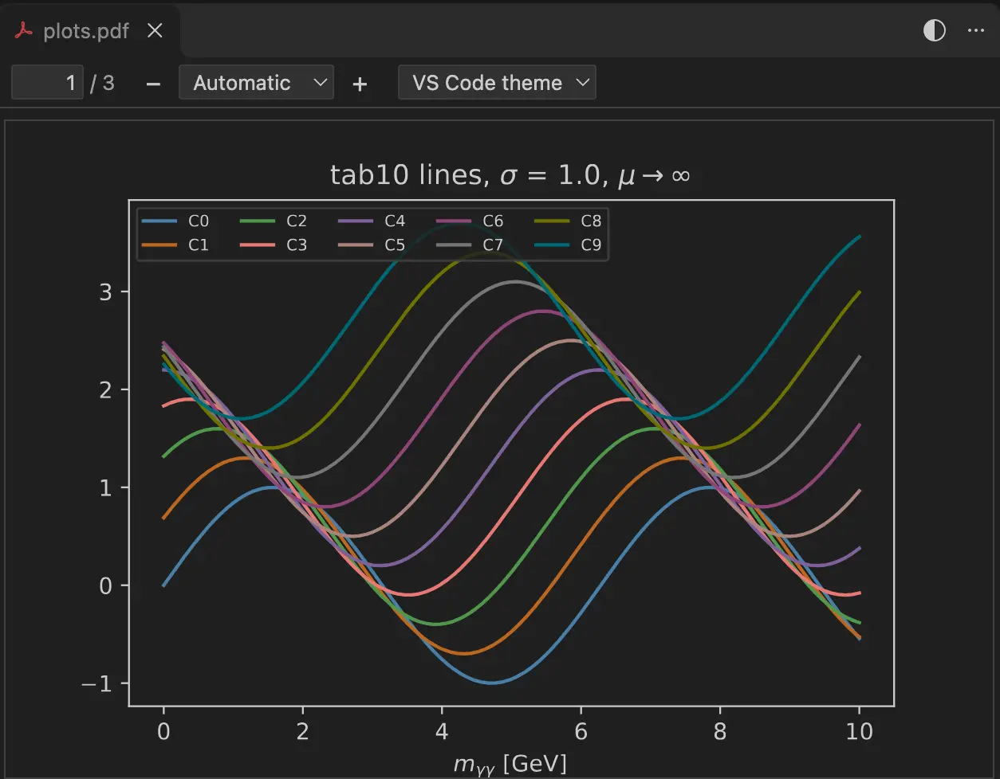
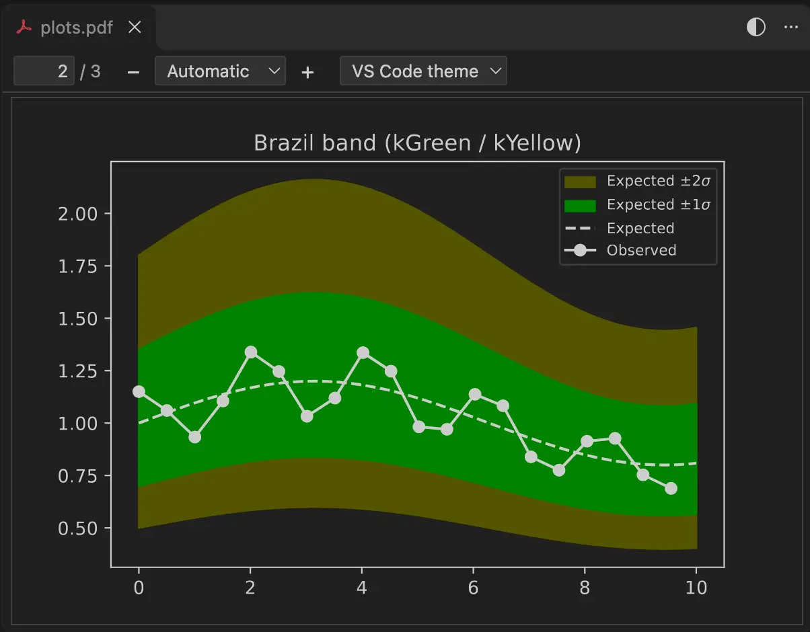
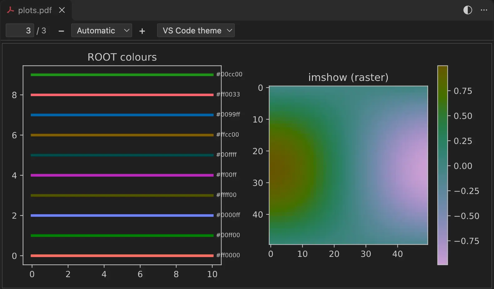

# PDF Preview Dark

Dark PDF preview for VS Code that keeps plot colours. Made for reading plots on a remote machine over Remote-SSH.



## Ready to use

Install it and open a `.pdf`. There is nothing to set up.

- The page follows your VS Code theme, and changes when you switch themes.
- The page fits the pane, and refits when you resize it.
- Lines keep their hue. Red stays red and blue stays blue.
- The preview reloads when the file changes, and stays on the same page and zoom. It waits until the file is fully written, so you never see half a plot.
- Files on `/afs` and `/eos` are also checked every 2 s, since file watching misses writes from batch jobs.
- Install it once on your own machine. It then works on every SSH host.



## Colours

Press `Alt+I`, or click the half-circle button in the title bar, to see the original colours.

To change the look, use the drop-down in the toolbar or the `pdfPreviewDark.colorScheme` setting. The choices are `vscodeTheme` (default), `oled`, `oneDark`, `solarizedDark`, `sepia`, `custom` and `off`.

Bright colours such as yellow stay visible on a dark page. Images inside the PDF change too, and so does their colour bar, so the values still read right.



## Keys

| Key | Action |
|---|---|
| `+` / `-` | Zoom in or out |
| `0` | Back to the default zoom |
| `Ctrl` or `Cmd` + wheel, or pinch | Zoom at the pointer |
| `Ctrl+F` / `Cmd+F` | Find text |
| `Alt+I` | Original colours on or off |

## Settings

| Setting | Default | |
|---|---|---|
| `pdfPreviewDark.colorScheme` | `vscodeTheme` | Colour scheme |
| `pdfPreviewDark.customColors.background` | `#1e1e1e` | Page colour for `custom` |
| `pdfPreviewDark.customColors.foreground` | `#d4d4d4` | Ink colour for `custom` |
| `pdfPreviewDark.hueMode` | `balanced` | `css` copies CSS invert and hue-rotate. `off` is a plain invert |
| `pdfPreviewDark.defaultZoom` | `auto` | `auto` shows the whole page for landscape plots and the full width for portrait pages. Also `page-width`, `page-fit`, `page-actual`, or a percent such as `150` |
| `pdfPreviewDark.reload.enabled` | `true` | Reload when the file changes |
| `pdfPreviewDark.reload.poll` | `auto` | `always` or `never` to override the `/afs` and `/eos` check |
| `pdfPreviewDark.reload.pollInterval` | `2` | Seconds between checks |

## Another PDF viewer opens instead?

VS Code asks which viewer to use when you have more than one. To always use this one, add this to your settings.

```json
"workbench.editorAssociations": {
  "*.pdf": "pdfPreviewDark.preview"
}
```

If something goes wrong, open the **Output** panel and pick **PDF Preview Dark**.

## Licence

MIT. The bundled PDF.js files keep their own licences, see [ThirdPartyNotices.md](ThirdPartyNotices.md).

To build from source, run `npm install`, then `npm test` and `npx vsce package`.
